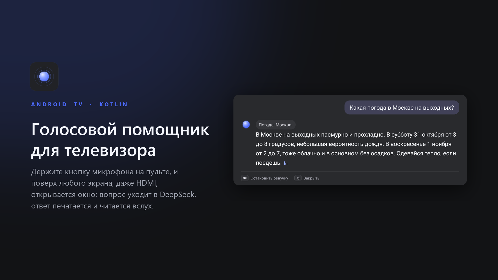
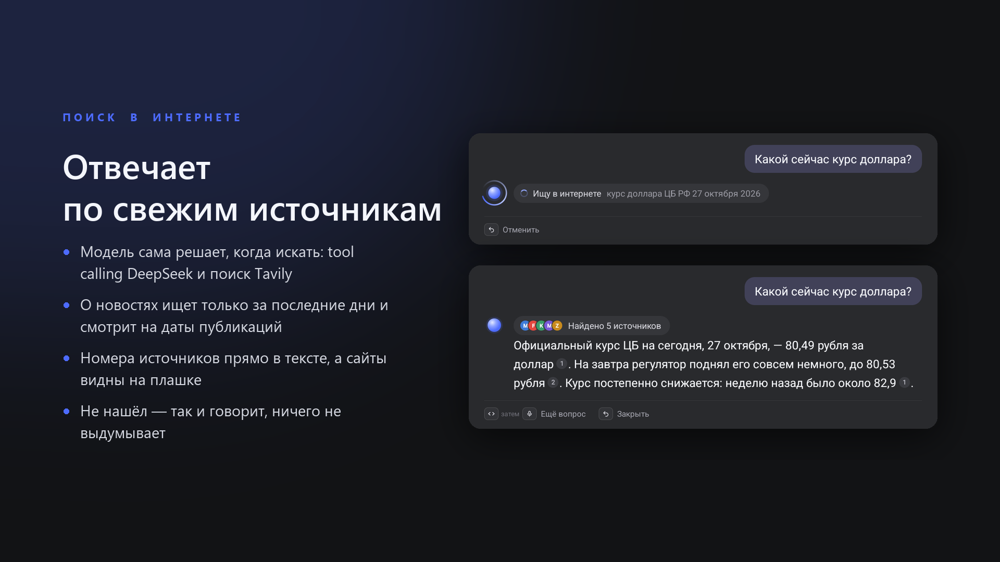
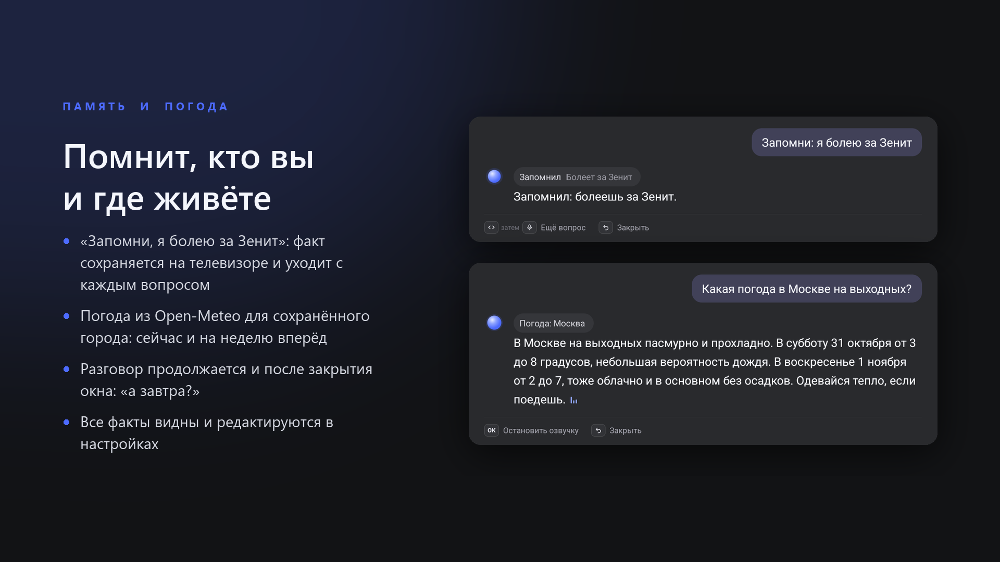
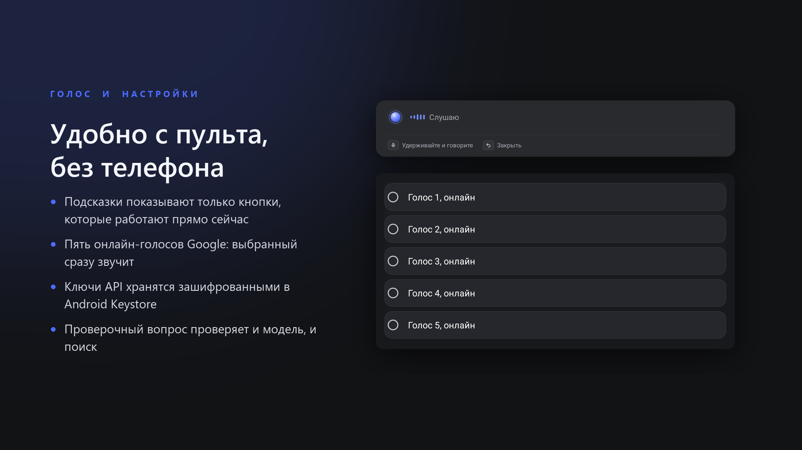
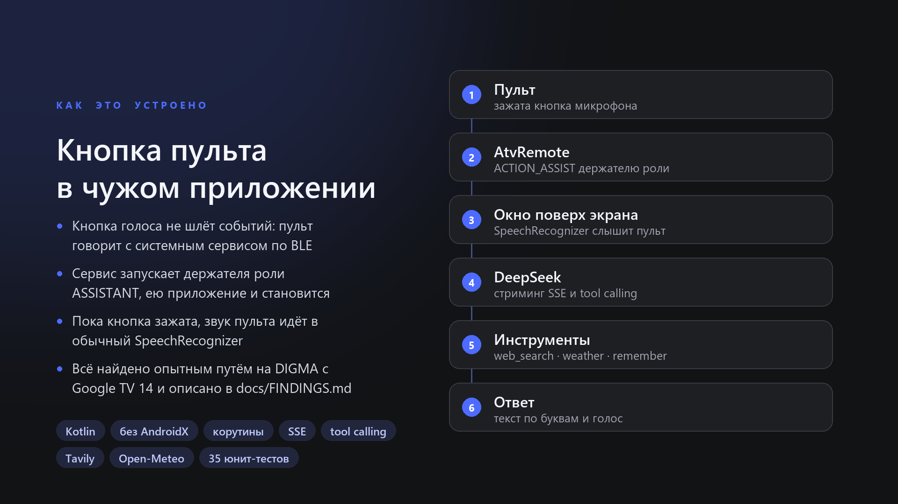

# Голосовой помощник для Android TV

Держите кнопку микрофона на пульте, и поверх любого экрана, даже поверх HDMI-входа, открывается окно: вопрос уходит в DeepSeek, ответ печатается по буквам и читается вслух. Помощник ищет в интернете со ссылками на источники, знает погоду, помнит, кто вы, и честно говорит, чего не умеет.

*A voice assistant for Android TV: hold the remote's mic button over any screen, HDMI included, and DeepSeek answers in text and voice, with web search, weather and memory.*



Все снимки сделаны на настоящем телевизоре (DIGMA DM-LED65UQB31, Google TV 14).

## Что умеет



- **Ищет в интернете, когда нужно.** Модель сама вызывает инструмент `web_search` (tool calling DeepSeek, поиск Tavily). О недавних событиях ищет только среди свежих новостей и смотрит на даты публикаций. Номера источников стоят прямо в тексте, а сайты видны на плашке.
- **Не выдумывает.** Если не нашла, так и говорит. Не делает вид, что сменила канал или громкость: управлять телевизором она не умеет и прямо об этом говорит.



- **Помнит вас.** «Запомни, я живу в Казани» сохраняет факт на телевизоре (`remember`/`forget`). Факты уходят с каждым вопросом, поэтому погоду и новости помощник ищет сразу для вашего города. Факты видны и редактируются в настройках.
- **Знает погоду.** Open-Meteo без ключа: погода сейчас и прогноз до 7 дней по местному времени.
- **Держит нить разговора.** Последние вопросы помнятся 30 минут, поэтому «а завтра?» работает и после закрытия окна.



- **Удобен с пульта.** Внизу показаны только те кнопки, которые работают прямо сейчас. Переходы между состояниями плавные. Ключи вводятся пультом или клавиатурой телефона и хранятся зашифрованными в Android Keystore.
- **Голос на выбор.** Пять онлайн-голосов Google, выбранный голос сразу звучит.

## Как кнопка пульта попала в стороннее приложение



Кнопка голоса на пульте не шлёт обычных событий клавиш: пульт общается с системным сервисом `AtvRemote` по Bluetooth. Опытным путём выяснилось:
- этот сервис запускает приложение, которое держит роль `ASSISTANT`;
- пока кнопка зажата, звук пульта попадает в обычный `SpeechRecognizer`.

Подробности, логи и подводные камни (например, почему нужно нажать стрелку перед следующим вопросом) описаны в [docs/FINDINGS.md](docs/FINDINGS.md).

## Устройство

Kotlin, без AndroidX и сторонних UI-библиотек; из зависимостей только корутины.

| Часть | Файлы |
|---|---|
| Окно поверх экрана, состояния и подсказки | `AssistActivity.kt`, `res/layout/activity_assist.xml` |
| Диалог, стриминг SSE, tool calling | `chat/ChatClient.kt`, `chat/Sse.kt`, `chat/Conversation.kt`, `chat/Answerer.kt`, `chat/Tools.kt` |
| Поиск (Tavily) и погода (Open-Meteo) | `search/WebSearch.kt`, `weather/Weather.kt` |
| Память о пользователе и недавний разговор | `settings/Memory.kt` |
| Ключи в Android Keystore | `settings/SecureStore.kt`, `settings/Prefs.kt` |
| Распознавание речи и озвучка | `voice/VoiceInput.kt`, `voice/Speaker.kt`, `text/SentenceBuffer.kt` |
| Анимации: шар, волна, мерцающий текст, печать | `ui/` |

Озвучка начинается с первого законченного предложения, не дожидаясь всего ответа. Вызовы движка речи вынесены в отдельный поток: у Google он живёт в одном процессе с распознаванием, и синхронный вызов подвешивал окно на секунды.

## Установка

Нужны Android SDK, JDK 17 и телевизор с Google TV, на котором включена отладка по сети.

```bash
./install.sh 192.168.1.50
```

Скрипт собирает приложение, ставит его, даёт доступ к микрофону и назначает его помощником. Затем откройте приложение из списка и введите ключ [DeepSeek](https://platform.deepseek.com) и, по желанию, ключ поиска [Tavily](https://tavily.com).

Google Assistant (`com.google.android.katniss`) лучше отключить: его детектор горячего слова мешает распознаванию.

## Тесты

```bash
./gradlew testDebugUnitTest
```

35 юнит-тестов: разбор потока SSE и вызовов инструментов, сборка запросов, поиск и погода на настоящих ответах API, память, разбивка ответа на предложения для озвучки.

## Данные и приватность

Ключи хранятся только на телевизоре, зашифрованными. Факты о пользователе тоже хранятся только на телевизоре, но уходят в DeepSeek вместе с вопросом, иначе модель не сможет ими пользоваться. Приложение слушает микрофон, только пока открыто окно.
