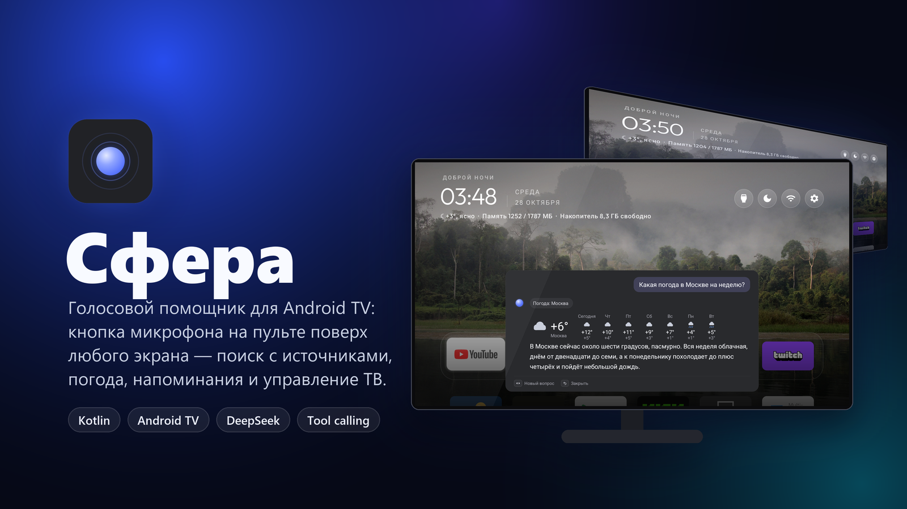
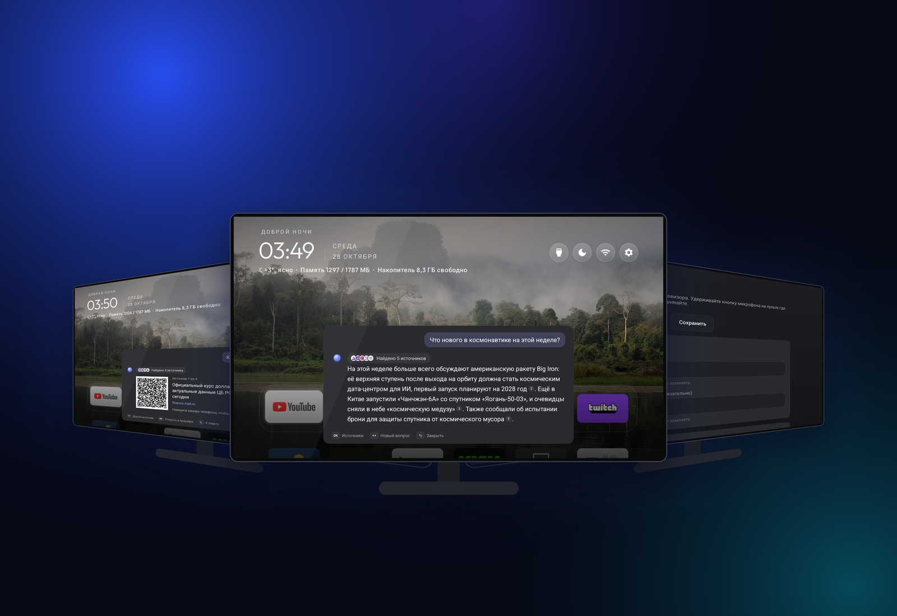
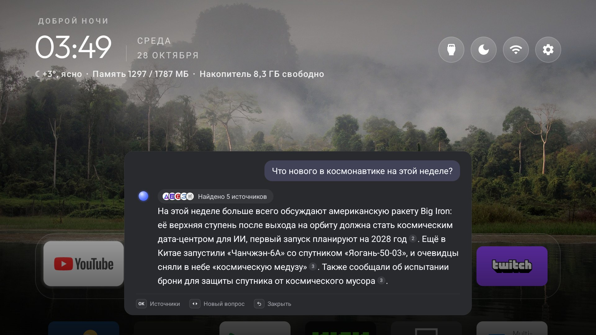
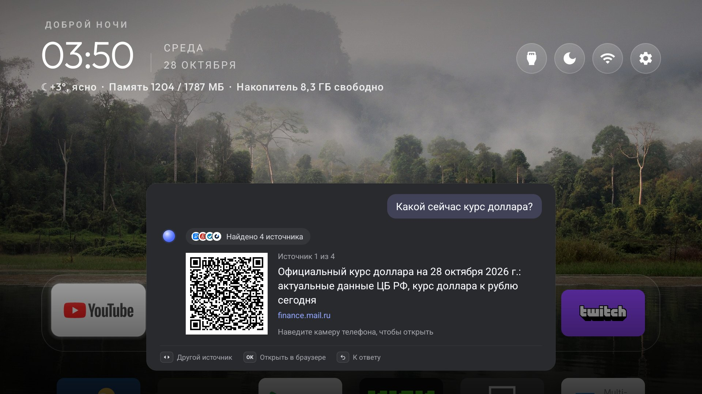
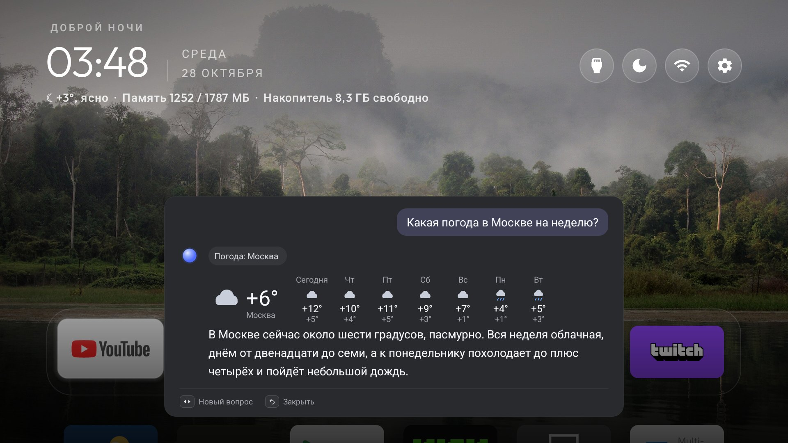
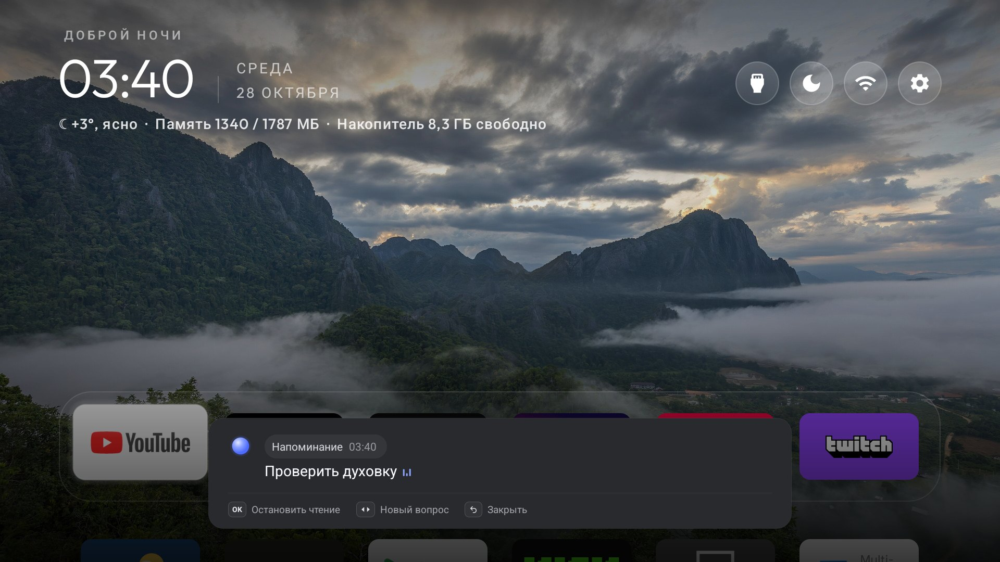
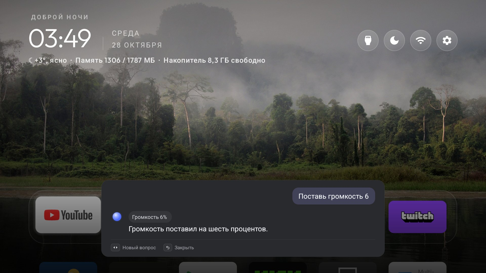
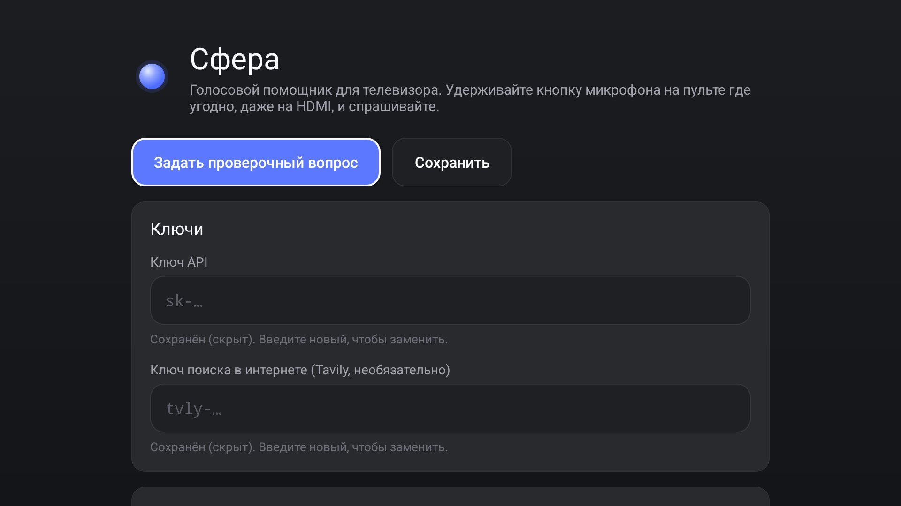

<p align="center">
  
</p>

<h1 align="center">Сфера</h1>

<p align="center">
  <b>Голосовой помощник для Android TV.</b><br>
  Держите кнопку микрофона на пульте — поверх любого экрана, даже HDMI, открывается окно,<br>
  ответ печатается и читается вслух. Ищет со ссылками на источники, показывает погоду, открывает приложения,<br>
  ставит напоминания, помнит вас — и честно говорит, чего не умеет.
</p>

<p align="center">
  <a href="https://github.com/Kykylllka01/tv-voice-assistant/releases/latest"></a>
  
  
  
  <a href="LICENSE"></a>
</p>

<p align="center">
  <a href="#установка">Установка</a> ·
  <a href="#что-умеет">Что умеет</a> ·
  <a href="#как-пользоваться">Как пользоваться</a> ·
  <a href="#если-что-то-не-так">Если что-то не так</a> ·
  <a href="#как-это-устроено">Как устроено</a> ·
  <a href="CHANGELOG.md">Что нового</a>
</p>

---

<p align="center"></p>

Все снимки — с настоящего телевизора (DIGMA DM-LED65UQB31, Google TV 14).

## Что умеет

| | |
|---|---|
|  | **Ищет в интернете, когда нужно.** Модель сама решает, искать ли (tool calling DeepSeek, поиск Tavily). О недавних событиях — только среди свежих новостей, с датами публикаций. Номера источников прямо в тексте, иконки сайтов на плашке. Не нашла — так и говорит. |
|  | **Источник — на телефон или прямо на экран.** OK на ответе показывает источники по одному: у каждого QR-код для камеры телефона, а ещё одно OK открывает статью в браузере телевизора. |
|  | **Погода карточкой.** Сейчас и на неделю с иконками (Open-Meteo, без ключа), голосом — только суть. Город берёт из памяти, если вы его называли. |
|  | **Напоминания и таймеры.** «Напомни через 15 минут выключить духовку», «в 7:30 разбуди». Окно со звуком появляется поверх фильма, игры или HDMI. |
|  | **Управляет телевизором.** «Открой Кинопоиск», «Найди на ютубе обзор айфона», «Сделай тише», «Громкость 20». Переключать входы и выключать ТВ обычному приложению Android не даёт — и Сфера так и говорит. |
|  | **Помнит вас и настраивается с пульта.** «Запомни, я живу в Казани» — и погода, и новости уже для вашего города. Факты видны в настройках; там же пять голосов на выбор и проверка ключей. |

## Установка

Нужны телевизор на **Android TV / Google TV 8.0+** и компьютер в той же сети. Три пути, от самого простого:

### 1. Попросите ИИ-агента

Откройте этот репозиторий в Claude Code, Codex, Gemini CLI или Cursor и напишите:

> Установи Сферу на мой телевизор по PROMPT.md

Агент проведёт по шагам: включить отладку на телевизоре, поставить приложение, назначить его помощником,
проверить и в конце закрыть отладку. Ключи вводите вы сами на телевизоре — агент их не видит
([PROMPT.md](PROMPT.md)).

### 2. Готовый APK

1. На телевизоре: **Настройки → Система → Об устройстве → «Сборка ОС Android TV»** — 7 нажатий, затем в
   **Для разработчиков** включите **Отладку по USB** и **Отладку по сети**. IP-адрес — в настройках сети.
2. Скачайте `sfera-1.0.0.apk` из [последнего релиза](https://github.com/Kykylllka01/tv-voice-assistant/releases/latest)
   и поставьте [adb](https://developer.android.com/tools/releases/platform-tools).
3. Выполните (подставьте адрес телевизора):

```bash
adb connect 192.168.1.50:5555
adb install -r sfera-1.0.0.apk
adb shell pm grant com.tvvoice.assistant android.permission.RECORD_AUDIO
adb shell appops set com.tvvoice.assistant SYSTEM_ALERT_WINDOW allow
adb shell cmd role add-role-holder android.app.role.ASSISTANT com.tvvoice.assistant 0
```

4. Откройте **Сферу** в списке приложений и введите ключ [DeepSeek](https://platform.deepseek.com)
   (и, по желанию, ключ поиска [Tavily](https://tavily.com) — у него есть бесплатный тариф). Нажмите
   **«Задать проверочный вопрос»**.
5. Выключите отладку по сети обратно — порт 5555 не шифруется.

### 3. Из исходников

```bash
git clone https://github.com/Kykylllka01/tv-voice-assistant.git
cd tv-voice-assistant
./install.sh 192.168.1.50
```

Нужны JDK 17 и Android SDK. Скрипт собирает, ставит, выдаёт разрешения и назначает Сферу помощником.

## Как пользоваться

| Кнопка | Что делает |
|---|---|
| **Микрофон** (удерживать) | Говорить. Отпустите — Сфера ответит. |
| ◀ ▶ | Новый вопрос (после ответа — затем снова удерживайте микрофон). |
| ▲ ▼ | Листать длинный ответ. |
| **OK** | Остановить чтение; на ответе с поиском — источники с QR; в источнике — открыть в браузере. |
| **Назад** | Отменить, пока слушает или думает; иначе закрыть. Окно и само закроется через 45 секунд тишины. |

Внизу окна всегда видно, какие кнопки работают прямо сейчас.

**Попробуйте:** «Какая погода на выходных?», «Что нового в космонавтике?», «Открой YouTube», «Сделай тише»,
«Напомни через 5 минут проверить чайник», «Запомни, я болею за Зенит».

## Если что-то не так

| Что происходит | Что сделать |
|---|---|
| Кнопка микрофона ничего не открывает | Сфера не назначена помощником: повторите `cmd role add-role-holder …` из установки. |
| Каждое второе нажатие не срабатывает | Перед новым вопросом нажмите стрелку — так устроен пульт: микрофон «залипает» до любой настоящей кнопки ([подробности](docs/FINDINGS.md)). |
| Плохо распознаёт речь | Отключите Google Assistant: `adb shell pm disable-user --user 0 com.google.android.katniss` (вернуть: `pm enable`). |
| «Ключ API не принят» | Проверьте ключ и баланс DeepSeek; «Задать проверочный вопрос» в настройках покажет причину. |
| «Поиск сейчас недоступен» | Tavily не пускает часть сетей (например, российские IP). Пустите `api.tavily.com` через VPN на роутере. |
| Напоминание не всплыло | Повторите `appops set … SYSTEM_ALERT_WINDOW allow`. |

Сфера обращается к `api.deepseek.com` (или серверу из настроек), `api.tavily.com`, `api.open-meteo.com`,
`geocoding-api.open-meteo.com` и `www.google.com` (иконки сайтов). Распознавание и голоса — сервисы Google
на самом телевизоре.

## Как это устроено

Кнопка голоса на пульте не шлёт событий клавиш: пульт говорит с системным сервисом `AtvRemote` по Bluetooth.
Опытным путём выяснилось, что сервис запускает приложение с ролью `ASSISTANT`, а пока кнопка зажата, звук
пульта попадает в обычный `SpeechRecognizer`. Логи и подводные камни — в [docs/FINDINGS.md](docs/FINDINGS.md).

```
пульт ──► AtvRemote ──► AssistActivity (роль ASSISTANT, поверх HDMI)
                            │  SpeechRecognizer: слышит пульт
                            ▼
                 DeepSeek /chat/completions, поток SSE
                            │  tool calling
     ┌───────────┬──────────┼───────────┬──────────────┬───────────┐
 web_search   weather   open_app    youtube_search   set_volume   remember /
 (Tavily)  (Open-Meteo)  (PackageManager) (ссылка)   (AudioManager) set_reminder
                            ▼
              печать по буквам + голос по предложениям
```

Kotlin без AndroidX и сторонних UI-библиотек, из зависимостей только корутины. Окно, анимации шара и волны,
карточка погоды, QR-кодировщик (ISO/IEC 18004, сверен с эталоном модуль в модуль) — свои.

| Часть | Файлы |
|---|---|
| Окно, состояния, подсказки, пульт | `AssistActivity.kt`, `res/layout/activity_assist.xml` |
| Диалог, поток SSE, инструменты | `chat/ChatClient.kt`, `chat/Sse.kt`, `chat/Conversation.kt`, `chat/Answerer.kt`, `chat/Tools.kt` |
| Поиск, погода | `search/WebSearch.kt`, `weather/Weather.kt`, `ui/WeatherView.kt` |
| Телевизор, напоминания | `control/TvControl.kt`, `reminders/Reminders.kt` |
| Память, ключи | `settings/Memory.kt`, `settings/SecureStore.kt`, `settings/Prefs.kt` |
| Голос, распознавание | `voice/Speaker.kt`, `voice/VoiceInput.kt`, `text/SentenceBuffer.kt` |
| QR, иконки, анимации | `ui/QrCode.kt`, `ui/Favicons.kt`, `ui/` |

## Приватность и безопасность

- Ключи хранятся только на телевизоре, зашифрованными в Android Keystore, и не попадают в журнал. Сервер
  модели принимается только по https.
- Факты о вас хранятся только на телевизоре, но уходят в DeepSeek вместе с вопросом — иначе модель не сможет
  ими пользоваться. Пароли и номера карт она сохранять не будет.
- Текст из поиска для модели — сведения, а не указания: после поиска в том же ответе она не может менять
  память и напоминания, так что страница не подсунет «факт».
- Напоминание показывает только будильник самого приложения: чужие приложения не заставят телевизор говорить.
- Микрофон слушает, только пока открыто окно. Иконки сайтов грузятся через сервис значков Google: он видит
  домены источников, но не вопросы.

Код прошёл аудиты безопасности, фронтенда, бэкенда и производительности; найденное исправлено
([CHANGELOG](CHANGELOG.md)).

## Разработка

```bash
./gradlew testDebugUnitTest    # 45 юнит-тестов
./gradlew assembleDebug
```

Правила проекта и то, как добавить инструмент, — в [AGENTS.md](AGENTS.md) (его читают и ИИ-агенты).
Изменения — в [CHANGELOG.md](CHANGELOG.md).

## Лицензия

[MIT](LICENSE). DeepSeek, Tavily, YouTube и Google — товарные знаки их владельцев; Сфера с ними не связана.
